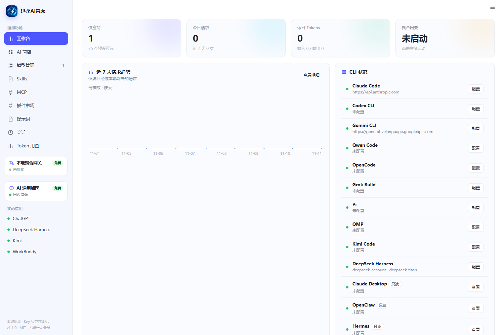

# 迅龙AI管家

一个**本地优先、无账号、无会员、无积分**的 AI 编程管家：把 Claude Code、Codex CLI、Gemini CLI、OpenCode、Kimi Code 等 10 个 CLI 的供应商配置、额度、会话、MCP 集中到一个面板里。

> 设计原则：所有配置只在本机，直连厂商，不做中转加价、不做账号体系；供应商切换前自动备份，随时可回滚。



更多界面见 [截图索引](docs/screenshots/README.md)。


## 功能

- **自动扫描本机**：一键检测已安装的 AI CLI 与桌面应用，并把你现有的配置（含 Key）直接导入供应商列表。
- **供应商管理**：10 个 CLI、75 个官方预设（Claude Code、Codex CLI、Gemini CLI、Qwen Code、OpenCode、Grok Build、Pi、OMP、Kimi Code、DeepSeek Harness），支持任意自定义端点、分组与搜索。
- **只读应用识别**：OpenClaw、Hermes、MiniMax Code、Claude Desktop 不写入配置，但会读取本机当前供应商、模型与配置路径，扫描时可导入为网关记录。
- **一键切换**：自动写入各 CLI 配置，改写前自动备份，可一键恢复。
- **聚合网关**：本地 OpenAI / Anthropic 兼容入口，多上游优先级 + 429/5xx 自动故障转移，支持 SSE 流式透传。
- **余额 / 额度**：DeepSeek、硅基流动、OpenRouter、Novita、Kimi、StepFun 官方余额接口。
- **用量统计**：按天、按供应商、按模型统计请求与 Token，保留最近请求明细。
- **MCP 管理**：增删改后一键写入 Claude Code / Codex / Gemini CLI / Qwen Code 四个 CLI。
- **提示词库**：内置 5 条工程提示词，支持 `{{变量}}` 占位与一键复制。
- **会话浏览**：Claude Code、Codex、Gemini CLI、Qwen Code、OpenCode，以及 Kimi / Copilot / iFlow / Grok / Pi / OMP 的 JSONL 会话；支持按应用筛选、搜索与按项目分组。
- **备份恢复**：手动备份 + 每次切换前自动备份，恢复前再存一份现场。
- **托盘 / 轻量**：Electron 托盘常驻，默认关闭窗口最小化到托盘（可在设置里关掉）。

## 快速开始

### 方式一：直接用打包好的 exe（推荐）

```
dist\迅龙AI管家-win32-x64\迅龙AI管家.exe
```

双击即用，无需安装 Node。数据目录：`%APPDATA%\XunlongAIManager`。打包时会把 `build/icon.ico` 写入 exe，资源管理器显示蓝龙标，不再是 Electron 默认的原子图标。

### 方式二：源码运行

```powershell
# 需要 Node.js 20+
npm install          # 或 pnpm install
npm run dev          # 只启动本地面板：http://127.0.0.1:20917
npm start            # Electron 桌面窗口
npm run pack         # 重新打包到 dist/，并写入 exe 图标与版本信息
npm test             # 适配器 / MCP / 备份 / 路由一致性测试
```

## 使用流程

1. 打开「供应商」→ 点「扫描本机」，自动识别已安装的 CLI 与现有配置，勾选后一键导入。
2. 或选应用（如 Claude Code）→「从预设添加」/「自定义添加」，填入自己的 API Key。
3. 点「切换到此」，面板会写入对应 CLI 配置（首次会备份原文件）。
4. 需要多供应商容灾时：到「聚合网关」→ 启动 → 把 CLI 的 Base URL 指向 `http://127.0.0.1:8317`，Key 随便填。
5. 在「用量统计」查看每一次调用的 Token 与耗时。

## 配置文件写入位置

| 应用 | 文件 |
| --- | --- |
| Claude Code | `~/.claude/settings.json`（`env.ANTHROPIC_BASE_URL` / `ANTHROPIC_AUTH_TOKEN` / `ANTHROPIC_MODEL`） |
| Codex CLI | `~/.codex/config.toml`（托管区块）+ `~/.codex/auth.json` |
| Gemini CLI | `~/.gemini/.env`（`GEMINI_API_KEY` / `GOOGLE_GEMINI_BASE_URL`） |
| Qwen Code | `~/.qwen/.env`（`OPENAI_API_KEY` / `OPENAI_BASE_URL` / `OPENAI_MODEL`） |
| Kimi Code | `~/.kimi-code/config.toml`（`[providers]` + `[models]` + `default_model`） |
| OpenCode | `~/.config/opencode/opencode.json` |
| Grok Build | `~/.grok/config.toml`（`[models]` + `[model."<name>"]`） |
| Pi | `~/.pi/agent/models.json` + `settings.json` |
| OMP | `~/.omp/agent/models.yml` |
| DeepSeek Harness | `~/.dsh/profiles/desktop/cordis.patch.yml` + `~/.dsh/.credentials.yaml` |

只读应用（仅读取，不写回）：OpenClaw `~/.openclaw/openclaw.json`、Hermes `%LOCALAPPDATA%\hermes\config.yaml`（或 `$HERMES_HOME/config.yaml`）、MiniMax Code `~/.minimax/config.yaml`、Claude Desktop `%APPDATA%\Claude\claude_desktop_config.json`（兼容 `%LOCALAPPDATA%\Claude`）。

文本类配置（Codex / Kimi / Grok / OMP / DSH）使用 `# >>> xunlong-ai-manager >>>` 托管标记，可随时删除；JSON / `.env` 采用字段级合并，不改其它字段。

## 项目结构

```
app/
├─ server.mjs            REST API + 静态资源 + 启动入口
├─ core/
│  ├─ paths.mjs          数据目录、CLI 配置路径
│  ├─ store.mjs          config.json 原子读写
│  ├─ presets.mjs        75 个预设
│  ├─ adapters.mjs       10 个 CLI 写入 + 4 个只读应用探测
│  ├─ config-parse.mjs   JSON5 / YAML / TOML 只读解析
│  ├─ gateway.mjs        聚合网关（故障转移 / SSE / usage）
│  ├─ balance.mjs        余额查询
│  ├─ usage.mjs          用量聚合
│  ├─ mcp.mjs            MCP 管理与同步
│  ├─ prompts.mjs        提示词库
│  ├─ sessions.mjs       会话解析
│  ├─ skills.mjs         本地技能扫描
│  └─ backup.mjs         备份 / 恢复
├─ electron/main.cjs     Electron 主进程
└─ ui/                   原生 SPA（无构建）
build/                   打包脚本与最终图标
├─ icon.png              窗口 / 任务栏 / 托盘图标
├─ icon.ico              exe 文件图标（16–256 px 多尺寸）
├─ make-icon.ps1         从 icon.png 生成 icon.ico
├─ rcedit.exe            打包时写入 exe 图标与版本信息
└─ pack.mjs
docs/
├─ brand/
└─ screenshots/          当前版本界面截图
tools/
└─ tests/                适配器 / MCP / 备份 / 路由测试
```

## 测试

```powershell
npm test
# 或单独运行
node tools\tests\test-app-adapters.mjs
node tools\tests\test-mcp.mjs
node tools\tests\test-backup.mjs
node tools\tests\audit-routes.mjs
```

> Windows PowerShell 若提示“禁止运行 npm.ps1”，把命令里的 `npm` 换成 `npm.cmd` 即可。

测试使用临时 HOME 和夹具配置，不会读取或修改真实用户文件；覆盖 Kimi/Codex/Grok/DSH/OMP 写入、Kimi 托管块替换、MCP 跨应用写入与停用清理、自动/手动备份恢复，以及 OpenClaw / Hermes / MiniMax / Claude Desktop 的只读探测。`audit-routes.mjs` 另做前后端 API 路由一致性检查。

## 常见问题

**Q：会不会把我原来的 Claude Code 配置弄坏？**
每次写入前都会备份到 `%APPDATA%\XunlongAIManager\backups`，并在「设置 → 备份与恢复」里可见；恢复前还会再存一份现场。仍建议首次使用前手动复制一份 `~/.claude`。

**Q：网关会把我 Key 传到哪？**
只在你指定的上游和自己本机之间流动。没有云账号、没有遥测、没有中转服务器。

**Q：备份里会有 Key 吗？**
会。手动备份与切换前自动备份都会复制本机应用配置，其中包含明文 Key；它们只保存在本机 `%APPDATA%\XunlongAIManager\backups`，请限制该目录权限并避免上传分享。

**Q：为什么没有游戏加速？**
这类加速通常要装内核驱动、TAP 网卡和证书，既不适合塞进一个配置管理工具，权限风险也高；需要时用系统代理即可。

## 文档与资产

- [截图索引](docs/screenshots/README.md)：工作台、供应商、应用详情、网关、设置、用量等当前界面。
- [测试工具](tools/README.md)：夹具测试与路由审计的用法。

## 合规说明

- 本项目为独立实现，未使用原软件的代码、图标、文案或 SDK。
- 不提供任何破解、绕过授权、共享账号的能力。
- 改写 CLI 配置、使用第三方模型服务前，请自行确认服务条款与所在地法规。

## License

MIT（本仓库代码）。第三方名称与商标归各自权利人。完整许可见 [LICENSE](LICENSE)。

